# Sequencial de 6 LEDs com NE555 e CD4017B — especificação, prancha e tutorial

Especificação técnica completa, prancha ilustrativa A3 e tutorial passo a passo de um
circuito sequencial de 6 LEDs (NE555 + CD4017B), reconstruídos a partir de um **único
print de esquemático**.

> **Por que este repositório existe.** No vídeo
> [“O porquê de eu não usar IA para desenvolver meu hardware”](https://www.youtube.com/watch?v=_Q3BPcyTtds)
> (canal JuliaLabs, 19/11/2026), a autora critica os “esquemáticos” gerados por IA que recebe
> e mostra, entre 2:22 e 2:40, o esquemático `projeto_sabado` de um projeto-aula dela. Este
> repositório usa esse trecho apenas como estudo de caso: o objetivo é mostrar que um LLM,
> guiado por uma instrução bem feita e obrigado a conferir cada número no datasheet do
> fabricante, consegue especificar, desenhar, compilar e orientar a montagem e o
> funcionamento do circuito. O projeto original e o vídeo pertencem à JuliaLabs; nada aqui é
> afiliado ao canal.

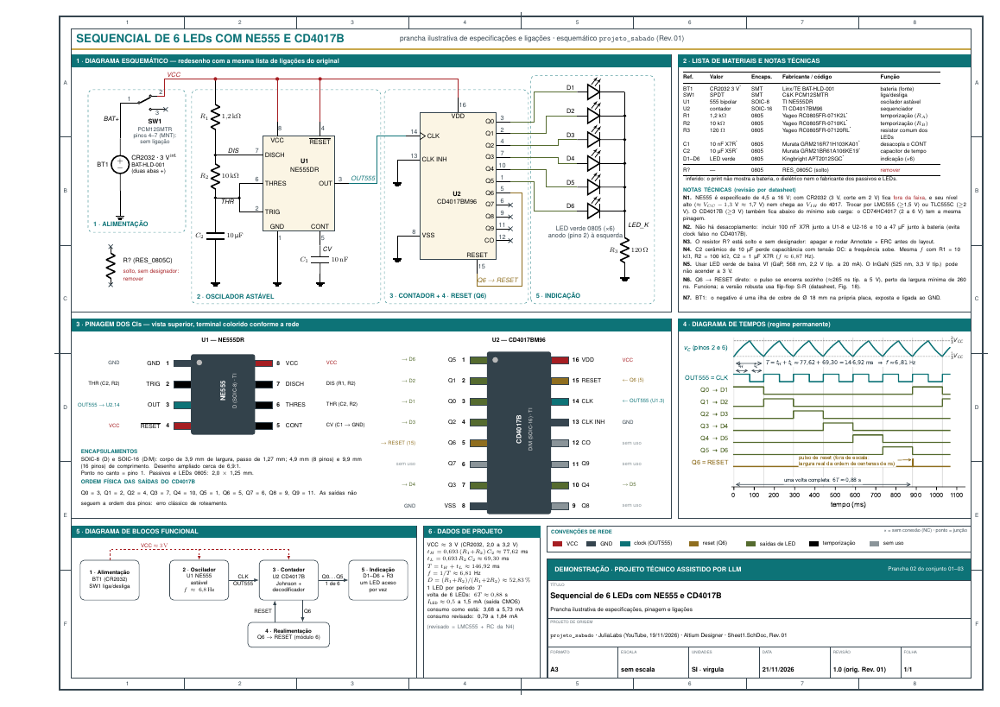

---

## Sumário

1. [Resumo em uma frase](#1-resumo-em-uma-frase)
2. [Documentos](#2-documentos)
3. [Resposta à pergunta do vídeo](#3-resposta-à-pergunta-do-vídeo)
4. [Esquemático e lista de ligações](#4-esquemático-e-lista-de-ligações)
5. [Lista de materiais](#5-lista-de-materiais)
6. [Tutorial passo a passo dos diagramas de blocos](#6-tutorial-passo-a-passo-dos-diagramas-de-blocos)
7. [Memorial de cálculo](#7-memorial-de-cálculo)
8. [Achados de revisão e recomendações](#8-achados-de-revisão-e-recomendações)
9. [O que não foi verificado](#9-o-que-não-foi-verificado)
10. [Como o trabalho foi validado](#10-como-o-trabalho-foi-validado)
11. [Como recompilar](#11-como-recompilar)
12. [Estrutura do repositório](#12-estrutura-do-repositório)
13. [Referências](#13-referências)

---

## 1. Resumo em uma frase

O **oscilador** (NE555) marca o ritmo, cerca de 6,8 vezes por segundo; o **contador**
(CD4017B) decide qual LED acende; a **realimentação** Q6 → RESET fecha a volta em seis
passos; e os **LEDs** mostram o resultado: a luz “corre” uma volta a cada 0,88 s.

## 2. Documentos

| Arquivo | Conteúdo |
|---|---|
| [`01-especificacao-tecnica.pdf`](01-especificacao-tecnica.pdf) | Especificação e memorial descritivo (16 p.): requisitos, componente a componente com datasheet, BOM, netlist, cálculos, conformidade, achados de revisão e comparação com microcontrolador |
| [`02-prancha-ilustrativa-A3.pdf`](02-prancha-ilustrativa-A3.pdf) | Prancha A3 com moldura, zonas e carimbo: esquemático, pinagem dos CIs, diagrama de tempos, blocos, BOM e notas técnicas |
| [`03-tutorial-diagramas-de-blocos.pdf`](03-tutorial-diagramas-de-blocos.pdf) | Tutorial passo a passo (12 p.), com o que medir na bancada em cada bloco |

## 3. Resposta à pergunta do vídeo

**É possível desenvolver a especificação completa a partir dos requisitos técnicos?** Sim,
desde que o ponto de partida seja um esquemático real e cada parâmetro seja conferido na
fonte primária (datasheet do fabricante), que é exatamente o método recomendado no vídeo.
O que não pôde ser confirmado está marcado como inferência.

**Há microcontrolador?** Não. O “cérebro” é lógica fixa: o NE555 gera o clock e o CD4017B
faz o sequenciamento. Mesmo assim, foi aplicada a cada CI a mesma lista de requisitos de um
projeto com microcontrolador: faixa de alimentação, desacoplamento, níveis lógicos, entradas
que não podem flutuar, corrente por pino, temporização, encapsulamento e pinagem.

**Para que serve?** É um sequencial (“corrida”) de 6 LEDs alimentado por bateria moeda
CR2032. Na placa com contorno de cabeça de gato exibida no vídeo, vira um enfeite
eletrônico; o objetivo principal é didático: um circuito clássico, todo SMD, que serve de
veículo para ensinar o fluxo completo de projeto de placa de circuito impresso.

## 4. Esquemático e lista de ligações

Redesenho com a **mesma lista de ligações do print original** (Rev. 01), reorganizado para
leitura da esquerda para a direita. As molduras tracejadas marcam os blocos funcionais.

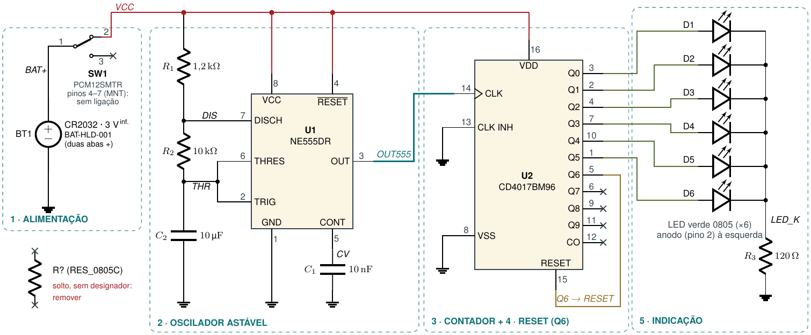

Cores de rede (sempre com rótulo de texto): **vermelho** VCC, **azul petróleo** clock
(OUT555), **dourado** reset (Q6), **oliva** saídas de LED. × = sem ligação.

| Rede | Pinos | Comentário |
|---|---|---|
| VCC | SW1-2, U1-8, U1-4, R1 (lado de cima), U2-16 | alimentação após a chave |
| GND | BT1 (–), U1-1, C1-2, C2-2, U2-8, U2-13, R3 (lado de baixo) | referência |
| BAT+ | BT1 (+, duas abas), SW1-1 | positivo antes da chave |
| DIS | U1-7, R1 (baixo), R2 (cima) | nó de descarga |
| THR | U1-6, U1-2, R2 (baixo), C2-1 | tensão do capacitor $v_C$ |
| CV | U1-5, C1-1 | referência 2·VCC/3 desacoplada |
| OUT555 | U1-3, U2-14 | clock (porta `OUT555` no original) |
| RST | U2-5 (Q6), U2-15 (RESET) | realimentação módulo 6 |
| LED1…LED6 | U2-3/D1-2, U2-2/D2-2, U2-4/D3-2, U2-7/D4-2, U2-10/D5-2, U2-1/D6-2 | pino 2 = anodo |
| LED_K | D1-1 … D6-1, R3 (lado de cima) | catodos comuns |
| NC | SW1-3, SW1-4 a 7 (MNT), U2-6, U2-9, U2-11, U2-12, R? | sem ligação |

### Pinagem dos CIs (vista superior)

| U1 — NE555DR (SOIC-8) | U2 — CD4017BM96 (SOIC-16) |
|---|---|
| 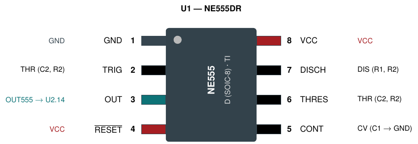 | 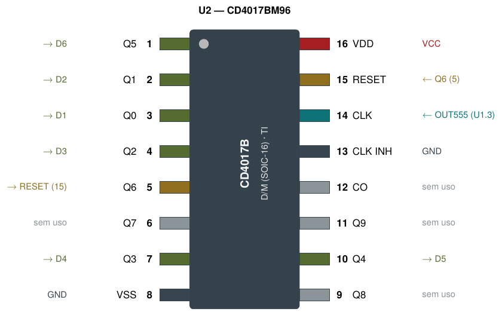 |

> **Atenção ao rotear:** as saídas do CD4017B **não seguem a ordem física dos pinos**:
> Q0 = 3, Q1 = 2, Q2 = 4, Q3 = 7, Q4 = 10, Q5 = 1, Q6 = 5, Q7 = 6, Q8 = 9, Q9 = 11.

## 5. Lista de materiais

| Ref. | Valor | Encaps. | Fabricante / código | Função |
|---|---|---|---|---|
| BT1 | CR2032, 3 V\* | SMT | Linx/TE BAT-HLD-001 | suporte da bateria |
| SW1 | SPDT | SMT | C&K PCM12SMTR | liga/desliga |
| U1 | 555 bipolar | SOIC-8 | TI NE555DR | oscilador astável |
| U2 | contador de década | SOIC-16 | TI CD4017BM96 | sequenciador |
| R1 | 1,2 kΩ | 0805 | Yageo RC0805FR-071K2L\* | temporização ($R_A$) |
| R2 | 10 kΩ | 0805 | Yageo RC0805FR-0710KL\* | temporização ($R_B$) |
| R3 | 120 Ω | 0805 | Yageo RC0805FR-07120RL\* | resistor comum dos LEDs |
| C1 | 10 nF X7R\* | 0805 | Murata GRM216R71H103KA01\* | desacopla o pino CONT |
| C2 | 10 µF X5R\* | 0805 | Murata GRM21BR61A106KE19\* | capacitor de temporização |
| D1–D6 | LED verde | 0805 | Kingbright APT2012SGC\* | indicação |
| R? | — | 0805 | RES_0805C | resíduo solto no original: **remover** |

\* inferido: o print não mostra a bateria, o dielétrico nem o fabricante dos passivos e LEDs.

---

## 6. Tutorial passo a passo dos diagramas de blocos

### Como ler um diagrama de blocos

Cada retângulo responde a uma pergunta: “o que este pedaço do circuito faz?”. **Seta
cheia** = sinal; **tracejado vermelho** = energia (VCC); **bloco em azul petróleo** = bloco
estudado no passo. Para qualquer bloco, o método é sempre o mesmo:
**(1)** o que entra, **(2)** o que sai, **(3)** que regra transforma a entrada na saída,
**(4)** como provar na bancada que a regra está sendo cumprida.

### Passo 0 — o sistema inteiro

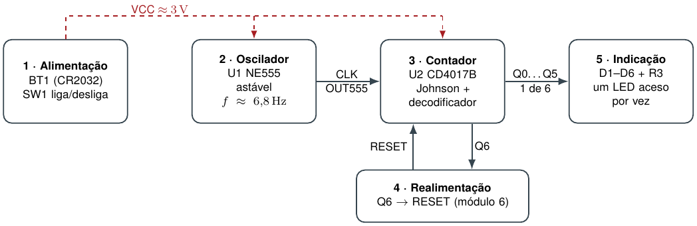

| Bloco | Entra | Sai | Componentes |
|---|---|---|---|
| 1 · Alimentação | energia da bateria | VCC ≈ 3 V com a chave ligada | BT1, SW1 |
| 2 · Oscilador | VCC | onda quadrada OUT555 ≈ 6,8 Hz | U1, R1, R2, C2, C1 |
| 3 · Contador | CLK e RESET | Q0…Q9, uma alta por vez | U2 |
| 4 · Realimentação | Q6 | RESET | fio do pino 5 ao 15 de U2 |
| 5 · Indicação | Q0…Q5 | um LED aceso por vez | D1–D6, R3 |

### Passo 1 — alimentação

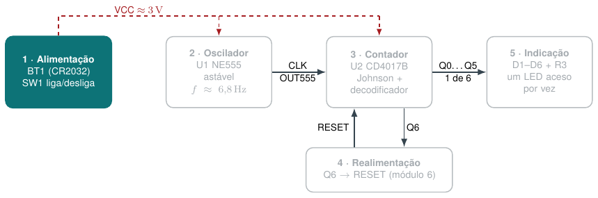

- **Entra:** energia da CR2032. **Sai:** VCC para U1 (pinos 8 e 4) e U2 (pino 16).
- **Como funciona:** o suporte BAT-HLD-001 faz o contato positivo pelo corpo metálico; o
  negativo é uma **ilha de cobre de Ø 18 mm na própria placa**, ligada ao GND. Segundo o
  símbolo, com a chave ligada o pino 1 (polo) vai ao pino 2 e o VCC aparece; na outra
  posição vai ao pino 3, sem ligação. O terminal comum real do PCM12 deve ser conferido no
  desenho do fabricante.
- **Ponto de atenção:** a célula entrega 3 V nova e cai a 2 V. O NE555 pede no mínimo 4,5 V
  e o CD4017B, 3 V (ver [achado A1](#8-achados-de-revisão-e-recomendações)).
- **Na bancada:** multímetro entre SW1-2 e GND: ≈ 3 V ligado, 0 V desligado. Se a tensão
  cai muito durante a oscilação, a bateria está no fim ou falta desacoplamento.

### Passo 2 — oscilador astável (NE555)

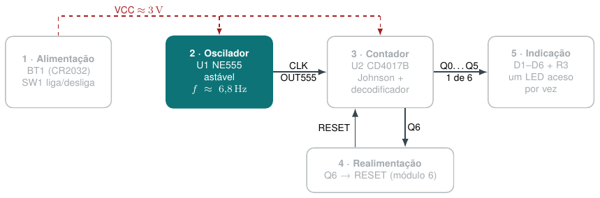

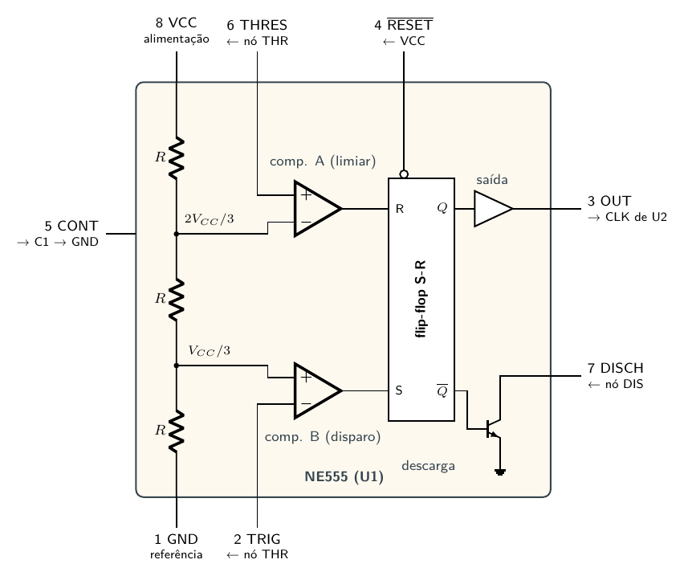

O ciclo em cinco momentos:

1. **Ao ligar**, C2 está em 0 V; TRIG < VCC/3, o comparador B seta o flip-flop: saída alta,
   descarga cortada.
2. **Carga:** C2 carrega por VCC → R1 → R2 → C2.
3. **Limiar:** em 2·VCC/3, o comparador A reseta o flip-flop: saída baixa, o transistor de
   descarga prende o pino 7 ao GND.
4. **Descarga:** C2 descarrega por R2 → pino 7 → GND. R1 continua conduzindo
   VCC/R1 = 2,5 mA direto para o GND (corrente desperdiçada).
5. **Disparo:** em VCC/3, o comparador B seta de novo e o ciclo recomeça.

Números: $t_H \approx 77{,}62$ ms, $t_L \approx 69{,}30$ ms, $T \approx 146{,}92$ ms,
$f \approx 6{,}81$ Hz, ciclo de trabalho ≈ 52,83 %. O primeiro nível alto após ligar é mais
longo: $(R_1+R_2)\,C_2 \ln 3 \approx 123{,}04$ ms.

> A frequência não depende de VCC: se a tensão cai, encolhe o caminho que o capacitor
> percorre, mas a corrente de carga cai na mesma proporção, e o tempo $\tau \ln 2$ não muda.

**Na bancada:** pinos 2/6 com exponencial entre ≈ 1 V e ≈ 2 V; pino 3 com quadrada de
≈ 6,8 Hz. Frequência muito alta → C2 perdeu capacitância (A4). Amplitude de só ≈ 1,7 V
no pino 3 → NE555 a 3 V: oscila, mas o CD4017B pode não contar (A1).

### Passo 3 — contador/decodificador (CD4017B)

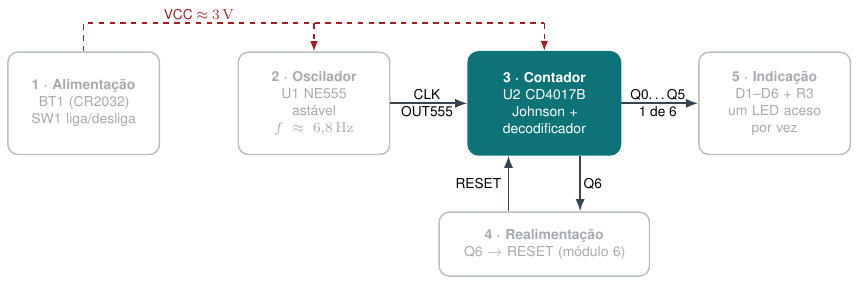

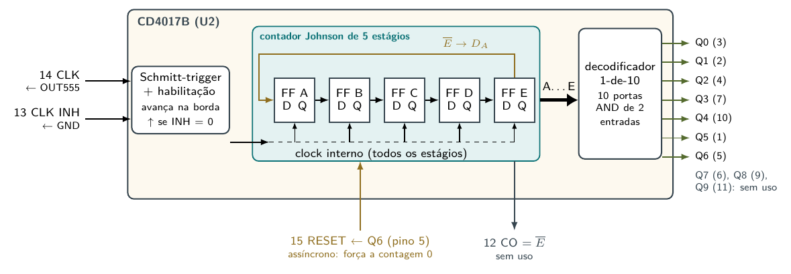

O clock passa por um gatilho Schmitt; com CLK INH (pino 13) no GND, cada **borda de
subida** avança a contagem. Um contador Johnson de 5 estágios percorre 10 estados, e o
decodificador liga exatamente uma das dez saídas.

| Contagem | A B C D E | Saída alta (pino) | LED |
|---|---|---|---|
| 0 | 0 0 0 0 0 | Q0 (3) | D1 |
| 1 | 1 0 0 0 0 | Q1 (2) | D2 |
| 2 | 1 1 0 0 0 | Q2 (4) | D3 |
| 3 | 1 1 1 0 0 | Q3 (7) | D4 |
| 4 | 1 1 1 1 0 | Q4 (10) | D5 |
| 5 | 1 1 1 1 1 | Q5 (1) | D6 |
| 6 | 0 1 1 1 1 | Q6 (5) | aciona o RESET |

**Na bancada:** pinos 3, 2, 4, 7, 10 e 1 ficam altos ≈ 147 ms cada, em sequência. Pinos 6,
9 e 11 ficam baixos; o pino 12 (CO) é alto de Q0 a Q4 e baixo em Q5 (período 0,88 s). Ao
ligar, sem reset de energização, a placa pode ficar até 3T ≈ 0,44 s apagada (partida em
Q7–Q9): é normal. Passos pulados → falta desacoplamento (A2).

### Passo 4 — realimentação (módulo 6)

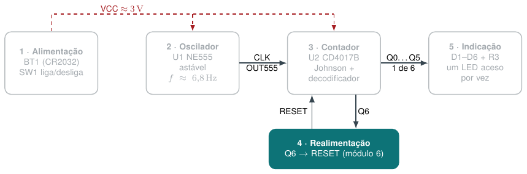

Na sexta borda de clock: Q5 cai e Q6 sobe; Q6 está ligado ao RESET (ativo em nível alto e
assíncrono), o contador zera, Q0 sobe e Q6 cai. Tudo dura centenas de nanossegundos
(atraso RESET → saída de 265 ns típicos a 5 V): para o olho, D6 apaga e D1 acende no
mesmo instante.

> **Regra geral do 4017:** para $N$ passos ($N < 10$), ligue $Q_N$ ao RESET. O datasheet
> (Fig. 18) mostra uma versão mais robusta com flip-flop S-R, que garante a largura do
> pulso de reset.

**Na bancada:** osciloscópio no pino 15, disparo único: pulso de centenas de ns a cada
0,88 s (o multímetro mostra 0 V).

### Passo 5 — indicação (LEDs)

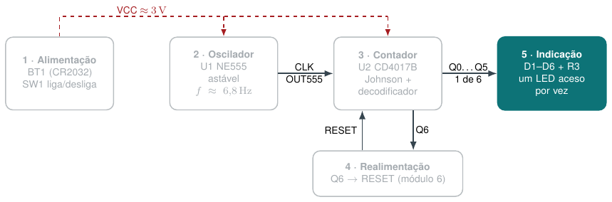

Cada saída alimenta o anodo de um LED; os catodos vão juntos ao GND por R3 (120 Ω). Como só
uma saída fica alta por vez, só um LED conduz e o brilho sai igual. A corrente fica entre
**0,5 e 1,5 mA**, limitada pela própria saída CMOS; por isso o LED precisa ser de baixa Vf
(verde GaP: 2,2 V típicos a 20 mA, cerca de 1,8 a 1,9 V nesta corrente).

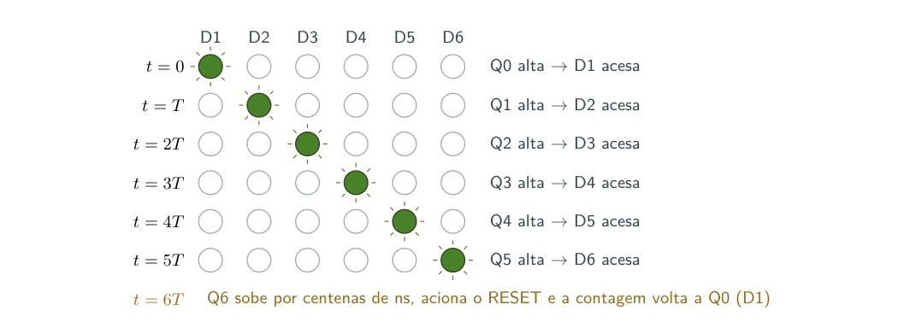

**Na bancada:** tensão sobre R3 entre 0,06 e 0,18 V (0,5 a 1,5 mA). LED que nunca acende →
polaridade invertida ou LED de Vf alta (A5).

### Passo 6 — integração: diagrama de tempos

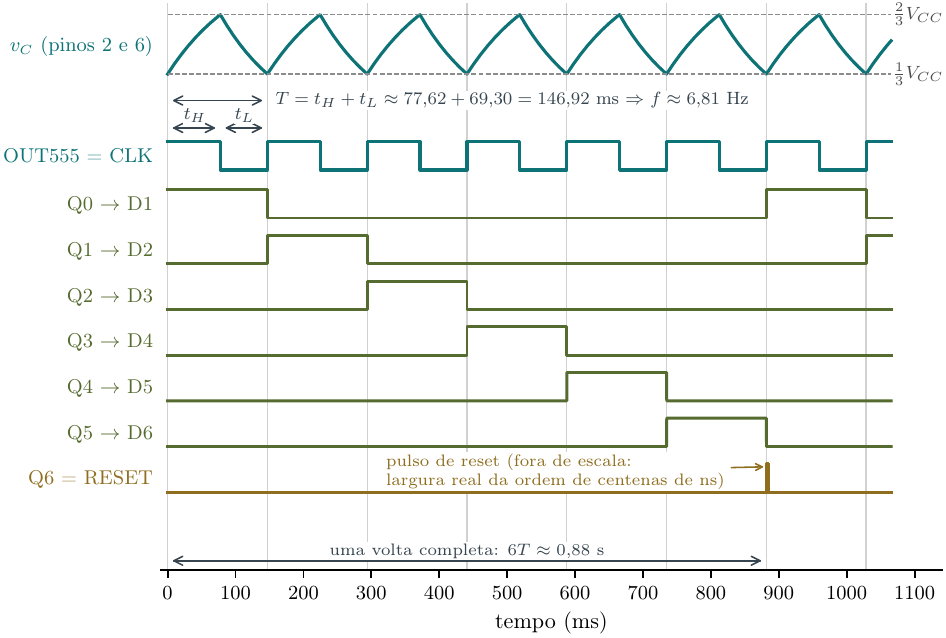

Cada linha cinza vertical é uma borda de subida do clock: nela uma saída desce e a próxima
sobe. Q0 fica alta de 0 a T e volta em 6T; a volta completa leva 6T ≈ 0,88 s.

### Passo 7 — do diagrama de blocos ao esquemático no Altium

No print original, a alimentação ocupa as zonas 1A–1B, o oscilador 1C–2D, o contador 3A–3B e
os LEDs 4A–4C. Os blocos 2 e 3 são ligados por duas **portas** `OUT555`; a anotação
`Sheet1[2A]` ao lado de uma porta é a referência cruzada do Altium (folha e zona onde está a
porta par). Numa folha única, sem símbolos de folha, o escopo automático vira plano e portas
homônimas se conectam.

### Passo 8 — roteiro de bancada

| Ponto | Instrumento | Esperado | Se não bater |
|---|---|---|---|
| VCC (SW1-2, U1-8, U2-16) | multímetro | ≈ 3 V; 0 V com a chave desligada | bateria, chave ou contato negativo do suporte |
| U1-2/U1-6 ($v_C$) | osciloscópio | exponencial entre ≈ 1 e 2 V | sem oscilação: 555 abaixo da tensão mínima (A1) |
| U1-3 (OUT555) | osciloscópio | quadrada ≈ 6,8 Hz, D ≈ 53 % | f alta: C2 (A4); amplitude ≈ 1,7 V: 4017 pode não contar (A1) |
| U2-14 (CLK) | osciloscópio | igual a U1-3 | trilha interrompida ou solda fria |
| U2-3, 2, 4, 7, 10, 1 | ponta lógica | pulsos de ≈ 147 ms em sequência | passos pulados: desacoplamento (A2) |
| U2-15 (RESET) | osciloscópio, disparo único | pulso de centenas de ns a cada 0,88 s | sem pulso: ligação Q6–RESET |
| Sobre R3 | multímetro | 0,06 a 0,18 V | LED invertido ou de Vf alta (A5) |
| Consumo total | multímetro em série | 3,68 a 5,73 mA com NE555 (estimado) | muito acima: curto ou componente invertido |

---

## 7. Memorial de cálculo

Fórmulas do datasheet do NE555, com $R_A = R_1 = 1{,}2$ kΩ, $R_B = R_2 = 10$ kΩ e
$C = C_2 = 10$ µF:

| Grandeza | Expressão | Valor |
|---|---|---|
| Tempo alto | $t_H = 0{,}693\,(R_1+R_2)\,C_2$ | 77,62 ms |
| Tempo baixo | $t_L = 0{,}693\,R_2\,C_2$ | 69,30 ms |
| Período | $T = t_H + t_L$ | 146,92 ms |
| Frequência | $f = 1/T$ (ou $1{,}44/[(R_1+2R_2)\,C_2]$ = 6,79 Hz) | 6,81 Hz |
| Ciclo de trabalho | $(R_1+R_2)/(R_1+2R_2)$ | 52,83 % |
| Volta de 6 LEDs | $6T$ | 0,88 s |
| Corrente desperdiçada em R1 (média, 3 V) | $V_{CC}/R_1 \cdot t_L/T$ | 1,18 mA |
| Corrente por LED (3 V) | limitada pela saída CMOS | 0,5 a 1,5 mA (estimado) |

| Consumo (a 3 V) | Como está | Com as recomendações |
|---|---|---|
| 555 | 2 a 3 mA (NE555) | ≈ 0,15 mA (LMC555) |
| Desperdício em R1 | ≈ 1,18 mA | ≈ 0,14 mA (R1 = 10 kΩ) |
| LED aceso | 0,5 a 1,5 mA | 0,5 a 1,5 mA |
| **Total** | **3,68 a 5,73 mA** | **0,79 a 1,84 mA** |
| Autonomia (225 a 254 mAh, limite superior) | 39,27 a 69,02 h | 122,28 a 321,52 h |

## 8. Achados de revisão e recomendações

| # | Gravidade | Achado | Correção |
|---|---|---|---|
| A1 | crítico | NE555 exige ≥ 4,5 V e a CR2032 dá 3 V (2 V no fim). O nível alto do NE555 (≈ VCC − 1,3 V ≈ 1,7 V) não chega ao $V_{IH}$ do 4017 (≈ 2,1 V a 3 V). O CD4017B (≥ 3 V) também fica abaixo do mínimo sob carga | LMC555 (≥ 1,5 V) ou TLC555C (≥ 2 V) no mesmo SOIC-8; CD74HC4017M96 (2 a 6 V, mesma pinagem) no lugar do CD4017B |
| A2 | importante | sem capacitores de desacoplamento | 100 nF X7R junto a U1-8 e U2-16; 10 a 47 µF junto à bateria |
| A3 | importante | resistor R? solto e sem designador | apagar; rodar Annotate + ERC antes do layout |
| A4 | moderado | C2 cerâmico de 10 µF perde capacitância com tensão DC | R1 = 10 kΩ, R2 = 100 kΩ, C2 = 1 µF X7R → f ≈ 6,87 Hz e menos corrente desperdiçada |
| A5 | moderado | LED verde InGaN (Vf ≈ 3,3 V) pode não acender a 3 V | LED GaP de baixa Vf (ex.: APT2012SGC) |
| A6 | informativo | entradas definidas, Q6 → RESET, R3 comum e porta `OUT555` estão corretos | — |
| A7 | informativo | Q6 → RESET direto: pulso de ≈ 265 ns, perto do mínimo de 260 ns (5 V) | versão robusta com flip-flop S-R (datasheet, Fig. 18) |
| A8 | informativo | PCM12SMTR consta como obsoleto na DigiKey | confirmar disponibilidade e terminal comum no desenho do fabricante |

## 9. O que não foi verificado

- Datasheet oficial da chave **PCM12SMTR** (o servidor do fabricante recusou o acesso):
  dados vieram de distribuidores.
- Curva de **perda de capacitância sob tensão DC** do capacitor de 10 µF.
- Comportamento do **CD4017B a 3 V**: o datasheet só tabela 5, 10 e 15 V.
- Código exato do **LED** e dos passivos (o print não os mostra).
- No print, o fio do **THRES** encontra o fio do laço de TRIG um passo de grade acima da
  ponta do pino de R2, onde está a junção. A leitura coerente é que tudo forma o mesmo nó;
  só a netlist exportada do Altium confirma.

## 10. Como o trabalho foi validado

1. Transcrição do vídeo lida para entender o contexto (0:00–3:21 e 7:33–10:47).
2. Cada ligação lida em recortes ampliados do print.
3. Datasheets oficiais levantados e conferidos por um agente de pesquisa, com página e
   tabela de cada valor.
4. Três revisores independentes: **ligações** (o redesenho tem as mesmas 11 redes do print,
   pino a pino), **técnico** (contas refeitas e afirmações conferidas nos PDFs oficiais) e
   **legibilidade das figuras** (lint estático e inspeção a 200 dpi). Todas as correções
   apontadas foram aplicadas.

## 11. Como recompilar

Requisitos: distribuição TeX (MiKTeX ou TeX Live) com `pdflatex`, `circuitikz`, `tcolorbox`,
`siunitx`; Python 3 com `numpy` e `matplotlib`.

```bash
python figuras/src/gerar_tempos.py                                  # diagramas de tempos
pdflatex -output-directory=build figuras/figs-prancha.tex           # figuras da prancha
cp build/figs-prancha.pdf figuras/figs-prancha.pdf
pdflatex -output-directory=build 01-especificacao-tecnica.tex       # rodar 2 vezes
pdflatex -output-directory=build 02-prancha-ilustrativa-A3.tex      # rodar 2 vezes
pdflatex -output-directory=build 03-tutorial-diagramas-de-blocos.tex # rodar 2 vezes
```

As imagens deste README vêm de `figuras/figs-prancha.pdf`, `figuras/blocos-passos.tex` e
`figuras/tempos-a4.pdf`, renderizadas com `pdftoppm -png -r 160`.

## 12. Estrutura do repositório

```
├── 01-especificacao-tecnica.{tex,pdf}
├── 02-prancha-ilustrativa-A3.{tex,pdf}
├── 03-tutorial-diagramas-de-blocos.{tex,pdf}
├── projeto-sabado.sty      # preâmbulo comum (cores, caixas, macros de pino de CI)
├── fontes-padrao.sty       # macros de fontes com polaridade travada (circuitikz)
├── referencias.tex         # fontes verificadas e trechos reutilizados
├── figuras/
│   ├── esquematico.tex     # esquemático redesenhado (CircuiTikZ)
│   ├── blocos.tex          # diagrama de blocos (com destaque por passo)
│   ├── ne555-interno.tex   # modelo funcional do 555
│   ├── cd4017-interno.tex  # modelo funcional do CD4017B
│   ├── pinagem.tex         # pinagem ilustrada SOIC-8 e SOIC-16
│   ├── figs-prancha.tex    # figuras avulsas da prancha
│   ├── blocos-passos.tex   # blocos destacados (imagens do README)
│   └── src/gerar_tempos.py # diagrama de tempos (matplotlib)
└── docs/img/               # imagens do README
```

## 13. Referências

- JuliaLabs. *O porquê de eu não usar IA para desenvolver meu hardware*. YouTube, 19 nov. 2026. https://www.youtube.com/watch?v=_Q3BPcyTtds
- Texas Instruments. *xx555 Precision Timers*, SLFS022K. https://www.ti.com/lit/ds/symlink/ne555.pdf
- Texas Instruments. *CD4017B, CD4022B CMOS Counter/Dividers*, SCHS027C. https://www.ti.com/lit/ds/symlink/cd4017b.pdf
- Texas Instruments. *CD74HC4017*, SCHS200D. https://www.ti.com/lit/ds/symlink/cd74hc4017.pdf
- Texas Instruments. *LMC555 CMOS Timer*, SNAS558O. https://www.ti.com/lit/ds/symlink/lmc555.pdf
- Texas Instruments. *TLC555 CMOS Timer*, SLFS043K. https://www.ti.com/lit/ds/symlink/tlc555.pdf
- TE Connectivity (Linx). *BAT-HLD-001*, desenho C-BAT-HLD-001-XX. https://www.te.com/en/product-BAT-HLD-001.html
- Panasonic. *CR2032 Datasheet*. https://energy.panasonic.com/dam/master/pdf/en/datasheet/lithium/CR2032_Datasheet_EN.pdf
- Energizer. *CR2032 Ultimate Lithium*. https://www.data.energizer.com/pdfs/ultimatecr2032EU0920.pdf
- Kingbright. *APT2012SGC* e *APT2012ZGC*. https://www.kingbrightusa.com/images/catalog/SPEC/APT2012SGC.pdf
- Yageo. *RC_L series*. https://yageogroup.com/content/datasheet/asset/file/PYU-RC_GROUP_51_ROHS_L
- Microchip. *ATtiny13A Data Sheet*, DS40002307A.
- Altium. *Multi-sheet & Hierarchical Designs*. https://www.altium.com/documentation/altium-designer/schematic/multi-sheet-hierarchical-designs
